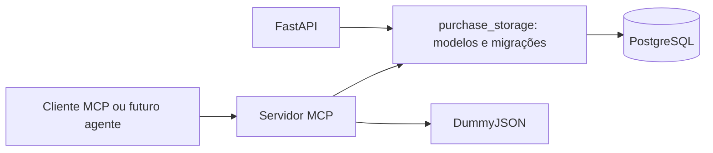

# purchase-agent-mcp

Agente de compras em desenvolvimento com FastAPI, servidor MCP independente, PostgreSQL e React/TypeScript. As ferramentas MCP `buscar_produtos(termo)` e `detalhar_produto(id)` consultam a DummyJSON; `criar_requisicao(request)` valida os produtos e grava uma requisição de compra no PostgreSQL. O agente OpenRouter e a interface de compras ainda não estão implementados.

## Iniciar com Docker Compose

Requisitos: Docker Engine/Desktop com containers Linux e Docker Compose v2.

Na raiz do repositório:

```powershell
Copy-Item .env.example .env
docker compose up --build
```

A cópia do `.env` é opcional: `docker compose up --build` funciona com os valores locais padrão. O Compose lê `.env` automaticamente. Para iniciar em segundo plano e aguardar os healthchecks:

```powershell
docker compose up --build -d --wait --wait-timeout 240
docker compose ps
```

Os quatro serviços devem aparecer como `healthy`. Na primeira execução, o download das imagens e dependências pode demorar.

| Serviço | Endereço no host | Endereço na rede do Compose |
| --- | --- | --- |
| Frontend | http://localhost:5173 | `frontend:80` |
| Backend | http://localhost:8000 | `backend:8000` |
| MCP | http://localhost:8001/mcp | `mcp-server:8001/mcp` |
| PostgreSQL | Sem porta publicada | `postgres:5432` |

A rede padrão do Compose permite resolver os nomes dos serviços por DNS. `localhost` dentro de um container aponta para esse próprio container. O navegador usa `/api/` no frontend; o Nginx encaminha esse caminho ao backend pela rede interna, removendo o prefixo. Exemplo: `http://localhost:5173/api/health` chega a `http://backend:8000/health`. O frontend continua estático e ainda não faz chamadas de compras.

## Configuração

- `POSTGRES_DB`, `POSTGRES_USER`, `POSTGRES_PASSWORD`: banco, usuário e senha.
- `BACKEND_PORT`, `MCP_PORT`, `FRONTEND_PORT`: portas publicadas no host. As portas internas permanecem fixas no Compose.
- `DB_STARTUP_ATTEMPTS`, `DB_STARTUP_INTERVAL_SECONDS`: limite e intervalo das tentativas de conexão do backend.
- `MCP_SERVER_URL`: o Compose fornece `http://mcp-server:8001/mcp` ao backend, reservado para a futura integração.
- `PRODUCT_API_TIMEOUT_SECONDS`: timeout positivo e finito do HTTPX na consulta à DummyJSON, padrão `10` segundos para cada fase de I/O (conexão, leitura, escrita e espera pelo pool). Valores inválidos impedem a inicialização do servidor MCP.

Os valores padrão são destinados ao desenvolvimento local: banco e usuário `purchase_agent`, senha de exemplo `purchase_local_only`. Substitua a senha em ambientes compartilhados. O `.env.example` não contém credenciais reais. Mantenha `.env` fora do Git. Valores vazios no `.env` usam os padrões definidos no Compose.

No Compose, backend e MCP recebem os mesmos campos de conexão do PostgreSQL; a URL é montada com `URL.create`, aceitando caracteres especiais na senha. `DATABASE_URL` é uma alternativa para executar esses processos fora do Compose, usando o formato `postgresql+psycopg://...`. Nesse caso, forneça as variáveis ao processo: os serviços não carregam `.env` automaticamente e o PostgreSQL precisa estar acessível fora da rede Docker.

`OPENROUTER_API_KEY`, `OPENROUTER_MODEL` e `VITE_API_BASE_URL` continuam reservados para etapas futuras. Nenhum segredo é enviado ao build do frontend. O proxy `/api/` já está configurado no Nginx.

## Inicialização e tratamento de falhas

1. O PostgreSQL inicia e seu healthcheck executa `pg_isready` via TCP.
2. O MCP aguarda o PostgreSQL saudável, inicializa o esquema e suas migrações, expõe `/health` e registra as três ferramentas via Streamable HTTP em `/mcp`.
3. O backend aguarda ambos ficarem saudáveis. No lifespan do FastAPI, tenta conectar ao banco com limite de tentativas e timeout por conexão; ao esgotar as tentativas, termina com erro explícito.
4. Ambos os processos usam a inicialização do pacote compartilhado: `create_all()` cria tabelas ausentes e uma migração SQL versionada atualiza o esquema anterior. Erros impedem a inicialização antes de aceitar requisições.
5. O frontend inicia após o backend ficar saudável e serve o build estático com Nginx.

Backend e MCP possuem engines e pools independentes com `pool_pre_ping`. Seus endpoints `/health` consultam o banco e retornam HTTP 503 se ele ficar indisponível, sem expor credenciais ou detalhes da exceção. Logs de inicialização não imprimem a URL do banco. Nenhum processo executa tentativas infinitas.

`create_all()` não altera colunas existentes. A atualização desta etapa está em `shared/purchase_storage/migrations/001_purchase_creation.sql` e é registrada em `purchase_schema_migrations`. A inicialização usa uma transação e um advisory lock do PostgreSQL para serializar execuções entre processos. A migração preserva linhas existentes e é executada uma única vez por banco.

## Arquitetura da persistência



`shared/` é um pacote Python instalável e independente de FastAPI, MCP e OpenRouter. Ele contém os modelos SQLAlchemy originais, a configuração e a inicialização do banco. Os imports antigos de `backend/app/models/` continuam disponíveis como reexportações. O MCP importa somente o pacote compartilhado; ele não importa `app.main` nem executa o processo do backend.

O serviço de criação usa `PurchaseRequestRepository` para ler e gravar os mesmos contratos de persistência. As chamadas bloqueantes de SQLAlchemy são executadas em threads; a consulta externa usa HTTPX assíncrono. A aplicação HTTP do MCP inicializa seu engine e as migrações no startup e descarta o pool no shutdown. O contexto de cada requisição MCP recebe o cliente de produtos e o repositório.

Os Dockerfiles Python agora usam a raiz do repositório como contexto para instalar `shared/`. Para builds manuais: `docker build -f backend/Dockerfile .` e `docker build -f mcp-server/Dockerfile .`. O Compose já fornece esses caminhos.

## Validar os serviços

Em PowerShell, com as portas padrão:

```powershell
Invoke-RestMethod http://localhost:8000/health
Invoke-RestMethod http://localhost:8001/health
Invoke-RestMethod http://localhost:5173/health
Invoke-RestMethod http://localhost:5173/api/health
docker compose logs backend mcp-server postgres frontend
```

O backend retorna `{"status":"ok","database":"ok"}`; MCP e frontend retornam `{"status":"ok"}`. A documentação FastAPI está em `http://localhost:8000/docs`. O endpoint `/mcp` recebe o protocolo MCP, não uma página web.

## Consultar produtos por MCP, sem LLM

A implementação usa o SDK oficial Python `mcp==1.30.0`, com Streamable HTTP, respostas JSON e transporte sem estado. As assinaturas públicas são `buscar_produtos(termo: str)`, `detalhar_produto(id: int)` e `criar_requisicao(request: PurchaseRequestInput)`. O parâmetro de contexto do SDK é interno e não aparece na descoberta das ferramentas.

O cliente HTTPX fica em `mcp-server/purchase_mcp/services/product_client.py`, separado das definições das ferramentas em `tools/product_search.py`. O SDK cria e fecha o cliente HTTPX no ciclo de vida de cada requisição MCP. As duas operações compartilham a requisição HTTP, o timeout, o tratamento de erros, a decodificação de JSON e a validação dos dados do produto.

A busca faz `GET https://dummyjson.com/products/search` com `q` enviado por `params`, sem concatenar o termo à URL. Espaços externos são removidos; termos vazios ou compostos apenas de espaços são rejeitados antes de qualquer chamada à API. O detalhamento faz `GET https://dummyjson.com/products/{id}`. O ID deve ser um inteiro positivo: zero, negativos, booleanos, strings e números decimais são rejeitados, sem consultar a API.

Para iniciar ou atualizar o MCP com sua dependência PostgreSQL, preservando os volumes:

```powershell
docker compose up --build -d --wait mcp-server
```

O cliente de teste incluído utiliza `ClientSession` e `streamable_http_client` do SDK oficial. Ele executa a negociação `initialize`, descobre as ferramentas com `tools/list` e chama `tools/call`, sem LLM:

```powershell
docker compose exec mcp-server python -m purchase_mcp.client phone --url http://mcp-server:8001/mcp
docker compose exec mcp-server python -m purchase_mcp.client --id 1 --url http://mcp-server:8001/mcp
```

O primeiro comando executa a busca; o segundo consulta o produto de ID `1`. Ambos testam o protocolo MCP real via HTTP e o nome interno do serviço na rede Docker. A forma anterior de buscar por termo continua funcionando. Também é possível executar o cliente no host, com as dependências do MCP instaladas:

```powershell
cd mcp-server
python -m purchase_mcp.client phone --url http://localhost:8001/mcp
python -m purchase_mcp.client --id 1 --url http://localhost:8001/mcp
```

A descoberta deve listar `buscar_produtos`, `detalhar_produto` e `criar_requisicao`. O resultado contém `isError` e `structuredContent`. Em caso de erro da ferramenta ou falha na conexão, o cliente termina com código de saída `1`. Informe um termo, `--id` ou `--create`, sem combinar essas opções.

### Contrato de saída

O contrato de `buscar_produtos` permanece:

| Campo | Significado |
| --- | --- |
| `status` | `success` quando existem produtos; `no_results` quando a API respondeu validamente sem resultados |
| `query`, `source` | Termo normalizado e origem `dummyjson` |
| `products` | Produtos retornados pela API, sem produtos locais de substituição |
| `total`, `skip`, `limit` | Metadados de paginação fornecidos pela DummyJSON; a busca mantém a primeira página e o limite padrão da API |

Para `detalhar_produto`, `structuredContent` contém `status=success`, `source=dummyjson` e `product`, com um único produto validado. O ID retornado pela API deve corresponder ao ID solicitado; uma resposta com outro ID é tratada como `invalid_response`. Um produto inexistente gera erro, sem retornar objeto de produto.

Cada produto contém `id`, `name` (campo `title` da API), `price` e `description`. Quando disponíveis, também são retornados categoria, marca, SKU, estoque, avaliação, desconto, disponibilidade, quantidade mínima, garantia, entrega, política de devolução, thumbnail, imagens e tags. Campos opcionais ausentes são `null`. Avaliações individuais e e-mails de avaliadores não são retornados.

O preço é convertido diretamente do número JSON para `Decimal`, sem cálculos com `float`, e serializado como string decimal em `structuredContent`. Não há conversão nem suposição de moeda: a resposta não informa uma moeda. A DummyJSON fornece um catálogo de demonstração; os dados exibidos são consultados na API, sem geração de produtos pela aplicação.

### Erros e logs

| Situação | Resultado MCP |
| --- | --- |
| Busca válida sem resultados | `isError=false`, `status=no_results`, `products=[]`, `total=0` |
| Termo vazio ou apenas espaços | `isError=true`, texto com código `invalid_term` |
| ID que não é inteiro positivo | `isError=true`, falha na validação dos argumentos MCP antes da chamada HTTP |
| Produto inexistente no detalhamento (HTTP 404 da DummyJSON) | `isError=true`, código `product_not_found` e texto indicando HTTP 404; nenhum produto é retornado |
| Timeout da API | `isError=true`, código `api_timeout` |
| Falha de rede ou protocolo HTTP | `isError=true`, código `api_unavailable` |
| Demais respostas HTTP fora de 2xx, inclusive 429 e 5xx | `isError=true`, código `api_http_error` e status HTTP; um 404 na busca mantém esse tratamento |
| Content-Type, JSON, produto ou paginação inválidos | `isError=true`, código `invalid_response` |

Falhas nunca são convertidas em listas vazias nem recebem produtos de substituição. Não há retentativas automáticas. Os logs da aplicação incluem status, contagem, duração e categoria de falha; não incluem termos de busca, corpos de resposta, credenciais ou URLs com parâmetros. Os logs detalhados de HTTPX e HTTPCore são limitados a WARNING.

### JSON-RPC manual em PowerShell

Para testar diretamente as mensagens do protocolo, sem usar o cliente Python, execute na ordem abaixo:

```powershell
$mcpUrl = 'http://localhost:8001/mcp'
$headers = @{ Accept = 'application/json, text/event-stream' }

$initialize = @{
    jsonrpc = '2.0'; id = 1; method = 'initialize'
    params = @{
        protocolVersion = '2025-11-25'
        capabilities = @{}
        clientInfo = @{ name = 'manual-test'; version = '1.0' }
    }
}
$handshake = Invoke-RestMethod -Uri $mcpUrl -Method Post -Headers $headers -ContentType 'application/json' -Body ($initialize | ConvertTo-Json -Depth 10)
$headers['MCP-Protocol-Version'] = $handshake.result.protocolVersion

$initialized = @{ jsonrpc = '2.0'; method = 'notifications/initialized' }
Invoke-RestMethod -Uri $mcpUrl -Method Post -Headers $headers -ContentType 'application/json' -Body ($initialized | ConvertTo-Json)

$list = @{ jsonrpc = '2.0'; id = 2; method = 'tools/list'; params = @{} }
Invoke-RestMethod -Uri $mcpUrl -Method Post -Headers $headers -ContentType 'application/json' -Body ($list | ConvertTo-Json)

$call = @{
    jsonrpc = '2.0'; id = 3; method = 'tools/call'
    params = @{ name = 'buscar_produtos'; arguments = @{ termo = 'phone' } }
}
$response = Invoke-RestMethod -Uri $mcpUrl -Method Post -Headers $headers -ContentType 'application/json' -Body ($call | ConvertTo-Json -Depth 10)
$response.result | ConvertTo-Json -Depth 20

$detailCall = @{
    jsonrpc = '2.0'; id = 4; method = 'tools/call'
    params = @{ name = 'detalhar_produto'; arguments = @{ id = 1 } }
}
$detail = Invoke-RestMethod -Uri $mcpUrl -Method Post -Headers $headers -ContentType 'application/json' -Body ($detailCall | ConvertTo-Json -Depth 10)
$detail.result | ConvertTo-Json -Depth 20
```

Como o transporte é sem estado, não é necessário guardar `Mcp-Session-Id`. O status HTTP 200 do envelope não garante sucesso da ferramenta: confira `result.isError`. Para testar ausência de resultados, use um termo inexistente; para validar a entrada, use `termo = '   '`. Ajuste a porta se `MCP_PORT` for alterada.

No detalhamento, altere `arguments.id` para `999999` para testar um ID inexistente e conferir o código `product_not_found`/HTTP 404; esse número não é tratado de forma especial pela aplicação. Use `0`, `-1`, `'1'`, `'abc'`, `$true` ou `1.5` para testar IDs inválidos. As falhas da ferramenta são transportadas no envelope MCP com `isError=true`; o HTTP 404 mencionado é o status da DummyJSON, não o status HTTP da requisição ao endpoint `/mcp`.

Para reproduzir os casos numéricos pela CLI:

```powershell
docker compose exec mcp-server python -m purchase_mcp.client --id 999999 --url http://mcp-server:8001/mcp
docker compose exec mcp-server python -m purchase_mcp.client --id 0 --url http://mcp-server:8001/mcp
```

Ambos devem retornar erro e código de saída `1`, sem produto fictício. A CLI usa `type=int` e rejeita textos e decimais localmente; os testes JSON-RPC acima verificam também a validação do servidor MCP.

## Criar uma requisição pelo protocolo MCP

O contrato é um argumento `request` com `title`, `requester_name`, `idempotency_key` (UUID) e `items`. Cada item aceita somente `product_id` e `quantity`, ambos inteiros positivos. A quantidade máxima acompanha o INTEGER do banco; são aceitos até 100 produtos distintos por chamada. Listas vazias, IDs repetidos, textos vazios, campos extras e preços/totais/moedas enviados pelo chamador são rejeitados por Pydantic.

O chamador escolhe quando usar a ferramenta. Nenhuma rota do backend prescreve uma sequência de ferramentas. É possível chamar `criar_requisicao` diretamente: a verificação dos produtos e preços ocorre dentro do serviço, mesmo sem busca ou detalhamento anteriores. O futuro agente pode usar o schema exposto em `tools/list`; a ferramenta declara `readOnlyHint=false` e idempotência condicionada à reutilização da mesma chave para a mesma intenção.

Em PowerShell, na raiz do projeto, gere uma intenção de teste uma única vez e guarde a chave para as retentativas. O comando de criação abaixo grava dados no banco do projeto:

```powershell
New-Item -ItemType Directory -Force tmp | Out-Null
$purchaseRequest = @{
    title = 'MCP test request'
    requester_name = 'Local tester'
    idempotency_key = [guid]::NewGuid().ToString()
    items = @(@{ product_id = 1; quantity = 2 })
}
$purchaseRequest | ConvertTo-Json -Depth 10 | Set-Content -Encoding UTF8 tmp/purchase-request.json
$OutputEncoding = [System.Text.UTF8Encoding]::new($false)
Get-Content -Raw tmp/purchase-request.json | docker compose exec -T mcp-server python -m purchase_mcp.client --create - --url http://mcp-server:8001/mcp
```

Repita somente a última linha, sem gerar outra chave, para verificar `replayed=true` e o mesmo `request_number`. Para uma nova intenção, gere outra chave. No host, a opção `--create` também aceita um caminho de arquivo UTF-8. O cliente executa a mesma negociação MCP, descoberta e `tools/call` das ferramentas de catálogo; não usa LLM.

Após o handshake JSON-RPC demonstrado na seção anterior, a chamada manual equivalente é:

```powershell
$createCall = @{
    jsonrpc = '2.0'; id = 5; method = 'tools/call'
    params = @{ name = 'criar_requisicao'; arguments = @{ request = $purchaseRequest } }
}
$created = Invoke-RestMethod -Uri $mcpUrl -Method Post -Headers $headers -ContentType 'application/json; charset=utf-8' -Body ($createCall | ConvertTo-Json -Depth 10)
$created.result | ConvertTo-Json -Depth 20
```

### Preços, transação e idempotência

1. O serviço procura a chave de idempotência antes de consultar a DummyJSON. Uma chave já gravada retorna o snapshot persistido; não há nova cotação nem nova gravação, inclusive se a API externa estiver indisponível.
2. Para uma nova chave, cada produto é consultado por `ProductClient.get_product`. Um produto inexistente ou falha da API interrompe a operação antes da transação de escrita.
3. O código calcula `unit_price`, `subtotal = unit_price × quantity` e `total` com `Decimal`. A precisão é de duas casas, com `ROUND_HALF_UP`, em conformidade com os campos `NUMERIC`; valores acima da capacidade das colunas são rejeitados. Desconto, frete, tributos e câmbio não são inferidos.
4. Cabeçalho, chave, fingerprint, preços, subtotais e itens são gravados numa única transação `sessionmaker.begin()`. Uma falha desfaz todos os inserts. A resposta só é retornada após o commit.
5. A chave possui índice único no PostgreSQL. Tentativas concorrentes são reconciliadas pela restrição de unicidade e uma nova leitura. A mesma chave com outro título, solicitante, produto ou quantidade gera `idempotency_conflict`; a ordem dos itens não altera a identidade da intenção.

O resultado estruturado contém `request_id`, `request_number` (UUID único), `created_at`, `replayed`, `currency`, `items` e `total`. Cada item contém produto, nome e descrição da API, quantidade, preço unitário e subtotal. Os valores decimais são strings JSON. A moeda permanece `null`, pois a DummyJSON não a informa.

Os modelos originais foram estendidos, preservando as duas tabelas. Novos campos são opcionais no esquema para manter os registros legados, mas sempre preenchidos nas gravações desta ferramenta. As linhas anteriores não recebem UUID, totais ou preços inventados. A migração preserva valores de moeda antigos; para novas linhas, remove o default BRL e permite `null`. A descrição dos itens passa de VARCHAR(255) para TEXT para preservar o conteúdo externo integral.

### Falhas e segurança

Além dos erros da integração já documentados, a criação retorna erros MCP com códigos `idempotency_conflict`, `invalid_amount`, `database_unavailable` ou `database_error`. Eles não incluem SQL, parâmetros, credenciais nem detalhes do driver. Em caso de falha de comunicação durante o commit, repita a chamada com a mesma chave: a leitura persistente reconcilia uma possível gravação já concluída. Os logs contêm apenas tipo de falha, contagem e indicador de repetição, sem solicitante, título, itens, preços, totais ou chave de idempotência.

Os preços vêm exclusivamente da API e são guardados como snapshot; não há aceitação de preços do LLM, nem SQL construído a partir dos argumentos. O endpoint MCP é publicado somente em `127.0.0.1` no host, e os serviços continuam se comunicando pela rede interna. Esta configuração local ainda não tem autenticação ou autorização por usuário: `requester_name` é um dado informado, não uma identidade verificada. A exposição remota e o futuro agente precisam de um controle de acesso confiável; a chave de idempotência não substitui autenticação.

## Validar a criação das tabelas

Com os valores padrão, execute os comandos abaixo. Caso tenha alterado `POSTGRES_USER` ou `POSTGRES_DB`, substitua os argumentos `-U` e `-d` pelos valores configurados.

```powershell
docker compose exec postgres psql -U purchase_agent -d purchase_agent -c '\dt'
docker compose exec postgres psql -U purchase_agent -d purchase_agent -c '\d purchase_requests'
docker compose exec postgres psql -U purchase_agent -d purchase_agent -c '\d purchase_request_items'
```

Para consultar diretamente o catálogo do PostgreSQL em PowerShell, com `POSTGRES_USER=purchase_agent` e `POSTGRES_DB=purchase_agent`:

```powershell
$catalogSql = @'
SELECT schemaname, tablename
FROM pg_catalog.pg_tables
WHERE schemaname = 'public'
  AND tablename IN ('purchase_requests', 'purchase_request_items')
ORDER BY tablename;
'@
$catalogSql | docker compose exec -T postgres psql -X -v ON_ERROR_STOP=1 -U purchase_agent -d purchase_agent
```

A consulta deve retornar exatamente as duas tabelas esperadas no schema `public`. Os argumentos `-U` e `-d` devem acompanhar os valores de `POSTGRES_USER` e `POSTGRES_DB` se forem alterados. Essa validação apenas lê o catálogo e não modifica tabelas ou volumes.

Devem existir:

- `purchase_requests`: campos originais e `request_number`, `idempotency_key`, `request_fingerprint` e `total_amount`.
- `purchase_request_items`: campos originais e `product_name` e `subtotal`.
- `purchase_schema_migrations`: controle das migrações executadas. A consulta filtrada acima continua retornando apenas as duas tabelas de negócio.

Confira `unit_price` como `numeric(14,2)`, `subtotal` e `total_amount` como `numeric(20,2)`, a chave estrangeira com `ON DELETE CASCADE` e as restrições de quantidade positiva e preço não negativo. Para inspecionar as gravações sem exibir nomes de solicitantes:

```powershell
docker compose exec postgres psql -U purchase_agent -d purchase_agent -c 'SELECT request_number, total_amount, currency FROM purchase_requests ORDER BY id DESC LIMIT 10;'
docker compose exec postgres psql -U purchase_agent -d purchase_agent -c 'SELECT purchase_request_id, product_id, quantity, unit_price, subtotal FROM purchase_request_items ORDER BY id DESC LIMIT 10;'
```

Adapte `-U` e `-d` se alterar `POSTGRES_USER` e `POSTGRES_DB`.

## Persistência e reinicialização

O volume nomeado `postgres-data` guarda os dados em `/var/lib/postgresql/data` (PostgreSQL 17). Para verificar a reinicialização preservando o volume:

```powershell
docker compose down
docker compose up -d --wait --wait-timeout 240
```

Repita os comandos de inspeção das tabelas. `docker compose down` preserva o volume. Não utilize o parâmetro `-v` nos testes: ele remove os volumes e apaga os dados locais. As variáveis `POSTGRES_*` inicializam um volume vazio; alterar usuário, senha ou nome do banco no `.env` não modifica um volume já inicializado. Para problemas de autenticação após mudanças, restaure os valores originais ou ajuste as credenciais no banco existente.

## Organização e dependências

- `compose.yaml`: quatro serviços e volume persistente na rede padrão.
- `shared/purchase_storage/`: modelos e configuração compartilhados, engine e migrações SQL versionadas.
- `backend/app/core/` e `backend/app/models/`: imports compatíveis do pacote compartilhado.
- `backend/app/database.py`: dependência de sessão FastAPI e reexportação da infraestrutura compartilhada.
- `backend/app/api/`, `services/`, `schemas/`: rotas e camadas de aplicação.
- `mcp-server/purchase_mcp/`: transporte MCP, healthcheck, cliente HTTPX, schemas Pydantic, repositório, serviço transacional, três ferramentas e cliente MCP de teste.
- `frontend/src/`: React, TypeScript e Vite; `frontend/nginx.conf`: arquivos estáticos, healthcheck e proxy.
- Cada componente tem seu Dockerfile e arquivo de dependências. O frontend usa `package-lock.json` e `npm ci` em build de múltiplos estágios.

## Verificações de desenvolvimento

O backend utiliza `unittest` e `httpx` apenas nas dependências de teste. A partir da raiz, com Python 3.12:

```powershell
python -m venv backend/.venv
backend/.venv/Scripts/python.exe -m pip install -r backend/requirements-test.txt
backend/.venv/Scripts/python.exe -m pip install -e ./shared
cd backend
.venv/Scripts/python.exe -m unittest discover -s tests -v
```

Esses testes validam configuração, tentativas de conexão, criação idempotente, relacionamentos, restrições, declaração PostgreSQL de `NUMERIC` e falhas do healthcheck. Os testes de armazenamento usam SQLite em memória; não substituem a validação real do PostgreSQL via Compose descrita acima.

### Suíte Pytest do servidor MCP

Os testes do MCP usam Pytest, HTTPX MockTransport e o plugin assíncrono do AnyIO (já utilizado pelo SDK). Eles não precisam de OpenRouter, chaves de LLM, serviços de desenvolvimento ou acesso à DummyJSON. Os contratos públicos das três ferramentas foram preservados.

Na raiz do repositório, prepare um ambiente Python 3.12 uma vez:

```powershell
python -m venv mcp-server/.venv
mcp-server/.venv/Scripts/python.exe -m pip install -r mcp-server/requirements-test.txt -e ./shared
```

Execute toda a suíte local com um comando:

```powershell
mcp-server/.venv/Scripts/python.exe -m pytest mcp-server -q
```

Com o ambiente ativado, basta `python -m pytest mcp-server -q`. No Linux/macOS, o executável do ambiente é `mcp-server/.venv/bin/python`.

O modo local usa um arquivo SQLite temporário novo para cada teste, com chaves estrangeiras habilitadas e suporte a múltiplas conexões. Apenas o teste de migração SQL específico de PostgreSQL é pulado nesse modo. A criação, os cálculos, as restrições, o rollback, a concorrência e as chamadas MCP são executados normalmente.

Para executar **todos os cenários com PostgreSQL real**, use um único comando na raiz:

```powershell
docker compose -f compose.test.yaml up --build --abort-on-container-exit --exit-code-from mcp-tests
```

O código de saída é o do Pytest: `0` indica sucesso. Mensagens PostgreSQL de violação de CHECK ou chave única são esperadas nos cenários que forçam rollback e concorrência; confira o resultado final do Pytest. A primeira construção da imagem e o download das dependências precisam de rede; a execução dos testes não usa serviços externos. A imagem de testes usa `Dockerfile.test` e dependências separadas; a imagem de execução do servidor continua sem Pytest.

Esse Compose é independente do `compose.yaml` de desenvolvimento. Ele possui projeto, serviços e rede próprios, não publica portas, não lê credenciais de aplicação e não monta volumes de desenvolvimento. O PostgreSQL guarda seus dados em `tmpfs`; a rede de teste é interna, sem saída para a internet. As credenciais fixas do arquivo são exclusivas desse banco descartável de teste.

Os containers de teste param ao término da suíte. Para remover somente esses containers e a rede de teste:

```powershell
docker compose -f compose.test.yaml down
```

Não é necessário nem utilizado `down -v`. Nenhum comando dessa suíte remove volumes da aplicação.

### Organização e cobertura

| Arquivo | Cenários |
| --- | --- |
| `tests/conftest.py` | Produtos de exemplo exclusivos dos testes, HTTPX MockTransport, bloqueio de HTTP externo, remoção de variáveis LLM, banco isolado e clientes MCP oficiais |
| `tests/test_product_search.py` | Resultados exatos da resposta simulada, ausência de resultados, termos inválidos, timeout, erros HTTP/rede e payloads inválidos |
| `tests/test_product_details.py` | Campos e tipos do produto, opcionais ausentes sem valores inventados, IDs inválidos, 404, divergência de ID e falhas externas |
| `tests/test_create_request.py` | Um ou múltiplos itens, quantidades, campos extras, preços do chamador rejeitados, Decimal, limites de armazenamento, persistência/relacionamentos, rollback e idempotência |
| `tests/test_mcp_integration.py` | Descoberta das três ferramentas com o SDK oficial, schemas JSON de entrada/saída, chamadas ASGI e TCP, erros MCP, persistência e ausência de gravações parciais |
| `tests/test_persistence.py` | Inicialização repetível, migração PostgreSQL preservando dados legados e duas tentativas simultâneas reconciliadas pela restrição única |
| `tests/test_configuration.py` | Timeout, bloqueio de chamadas não simuladas e rejeição de URLs de banco de desenvolvimento |

Cada teste recebe cópias independentes dos dados e um banco ou schema novo. A chave de idempotência da fixture é fixa para tornar os dados reproduzíveis, sem colisão entre testes. A disputa concorrente é coordenada por uma barreira; o teste não depende de qual thread vence.

O modo PostgreSQL usa apenas `TEST_DATABASE_URL`, aceita somente o driver `postgresql+psycopg` e o banco `purchase_mcp_test`, e cria um schema privado com nome aleatório para cada teste. Ao terminar, remove apenas esse schema. Não há fallback para `DATABASE_URL` ou `POSTGRES_*` de desenvolvimento. As chamadas HTTP externas não simuladas falham imediatamente.

O teste TCP inicia um servidor MCP local em uma porta livre e usa `ClientSession`/`streamable_http_client` do SDK oficial. Ele executa `initialize`, `tools/list` e `tools/call`, valida os schemas JSON e verifica os dados gravados. A DummyJSON continua simulada mesmo nesse teste. Não há LLM no processo.

### Limitações dos testes

- O modo SQLite não valida o dialeto e as migrações PostgreSQL; execute o Compose de testes para essa cobertura.
- As respostas externas são simuladas, portanto a suíte não detecta mudanças não representadas nas fixtures nem mede a disponibilidade da DummyJSON real.
- Não há testes de carga, tolerância a falhas do host ou autenticação; as verificações de concorrência cobrem duas gravações simultâneas com a mesma chave.

Os testes antigos do MCP em `unittest` e o script dependente da DummyJSON real foram substituídos pela suíte Pytest. Os testes do backend permanecem no fluxo independente descrito acima.

Para o frontend: `cd frontend`, `npm.cmd ci` e `npm.cmd run build`. No Linux/macOS, use `npm`. Node.js 22.12+ ou 24+ é necessário. Para desenvolvimento local do frontend, `npm.cmd run dev`; o proxy Nginx está disponível na versão Docker.

## Integração contínua (GitHub Actions)

O workflow `.github/workflows/ci.yml` executa em pushes para `main` e pull requests com destino a `main`. Um único job Ubuntu usa Python 3.12, instala `mcp-server/requirements-ci.txt` e o pacote compartilhado, executa Ruff no Python de `backend/`, `mcp-server/` e `shared/` e roda toda a suíte MCP com Pytest. Falhas de lint ou testes fazem o job falhar.

O cache do pip considera os arquivos de dependências e `shared/pyproject.toml`. Não há serviços PostgreSQL, chamadas à DummyJSON externa ou credenciais de LLM: `TEST_DATABASE_URL` vazio seleciona SQLite temporário, e as fixtures simulam o HTTP e removem as variáveis de chaves LLM. O único teste específico de migração PostgreSQL é pulado nesse modo; sua cobertura continua disponível pelo Compose de testes.

Para reproduzir as verificações localmente, na raiz, usando o ambiente virtual do MCP já criado:

```powershell
.\mcp-server\.venv\Scripts\python.exe -m pip install -r mcp-server/requirements-ci.txt -e ./shared
.\mcp-server\.venv\Scripts\python.exe -m ruff check backend mcp-server shared
.\mcp-server\.venv\Scripts\python.exe -m pytest mcp-server -q
```

O workflow possui apenas permissão de leitura do repositório e não realiza commits, merges ou publicação.

## Referências

- [Docker Compose: ordem de inicialização](https://docs.docker.com/compose/how-tos/startup-order/)
- [SQLAlchemy 2: modelos declarativos](https://docs.sqlalchemy.org/en/20/orm/declarative_tables.html)
- [FastAPI: lifespan](https://fastapi.tiangolo.com/advanced/events/)
- [SDK oficial MCP para Python, linha v1](https://github.com/modelcontextprotocol/python-sdk/tree/v1.x)
- [DummyJSON: produtos e busca](https://dummyjson.com/docs/products)
- [HTTPX: timeouts](https://www.python-httpx.org/advanced/timeouts/)
- [SQLAlchemy: transações de sessão](https://docs.sqlalchemy.org/en/20/orm/session_transaction.html)
- [PostgreSQL: advisory locks](https://www.postgresql.org/docs/17/explicit-locking.html#ADVISORY-LOCKS)
- [Pytest: fixtures](https://docs.pytest.org/en/stable/how-to/fixtures.html)
- [AnyIO: plugin de testes assíncronos](https://anyio.readthedocs.io/en/stable/testing.html)
